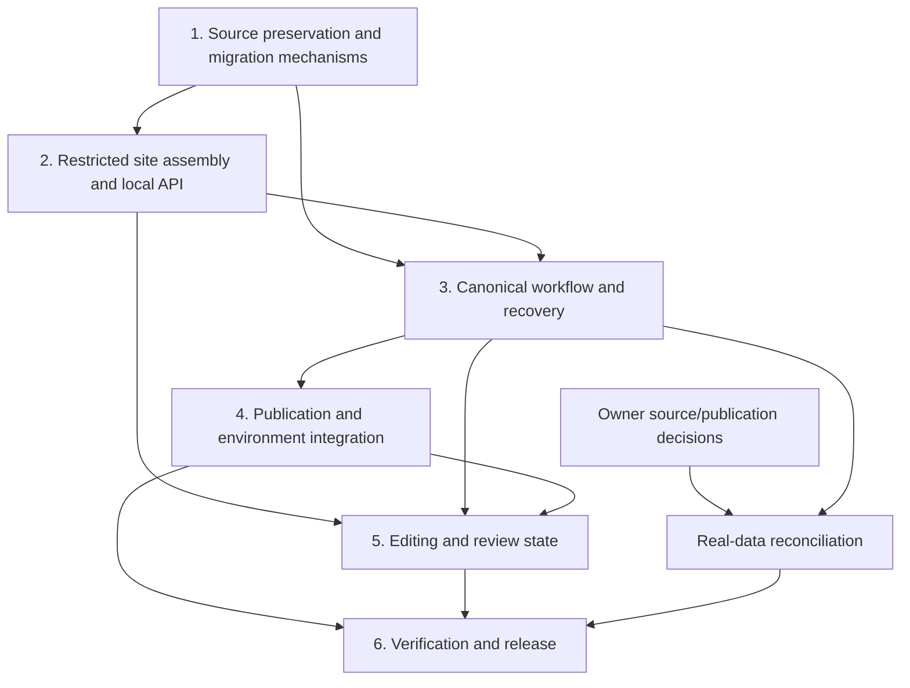

# Personal edition: agent implementation playbook

Status: planning documents only. No repair is marked implemented by this playbook.

Prepared: 2026-10-14. Inspected baseline: `d5dc772`. Primary working environment: Windows/PowerShell.

This playbook expands the [stabilization plan](../personal-edition-stabilization-plan.md) into six executable work stages. It is intended for an implementation agent that has subsequently been asked to perform the repairs. Writing or reading the plan does not itself deploy resources, migrate real family data, or publish a release.

## Start here

Read this file, the current repository `AGENTS.md`, the current stabilization plan, and the relevant stage before editing. Inspect the worktree and preserve work already present. Recheck file names and behavior: the baseline can change after these documents are written.

The required product outcome is a simple personal family tree: the owner edits locally, visitors can view the encrypted publication after unlocking, guests suggest changes, and the owner reviews and applies changes. The future commercial product is separate.

### The six stages

| Order | Stage | Main result | Existing work-package mapping |
| --- | --- | --- | --- |
| 1 | [Preserve and repair data](01-preserve-and-repair-data.md) | One verified canonical source, safe migration, explicit public-label decisions | PE-01 |
| 2 | [Secure local access](02-secure-local-access.md) | Restricted static output and a protected loopback API | PE-02; initial PE-04 assembly |
| 3 | [Unify saving and recovery](03-unify-saving-and-recovery.md) | One validation/encryption/generation/transaction workflow | PE-03 |
| 4 | [Stabilize publication and configuration](04-stabilize-publication-and-configuration.md) | Reproducible public output, safe environments, matched deployment metadata | PE-04 and PE-05 |
| 5 | [Repair editing and review behavior](05-repair-editing-and-review.md) | Correct draft/saved state, useful failures, dependable review/export | PE-06 |
| 6 | [Verify and release](06-verify-and-release.md) | Cross-platform evidence, restoration rehearsal, documented release | PE-07 and PE-08 |

Use the [verification matrix](verification-matrix.md) to track observable behavior and the [handoff templates](handoff-templates.md) to record progress. None of the proposed new commands or modules should be assumed to exist until their implementing task is complete.

## 1. Working agreement for the implementation agent

1. Preserve the single-maintainer/local-editing model. Keep the existing static viewer, guest suggestions, and isolated administrator review.
2. Work through the six stages in order. Small fixture-only changes may cross a stage boundary when a prerequisite requires it; record the reason.
3. Keep implementation changes reviewable. A stage can contain several changes; it does not require one oversized commit.
4. Do not create branches, commits, pull requests, cloud resources, or releases merely because this document names them. Follow the user's current authorization and active repository instructions.
5. Reading a private file locally is not permission to reproduce its contents in chat, tracked documents, test output, screenshots, commits, or hosted artifacts.
6. Build and exercise mechanisms with fictional fixtures first. Real-data reconciliation is a separate recorded operation.
7. Do not hide failures by weakening graph validation, skipping security assertions, increasing privileges, or making private fields public.
8. Do not introduce a framework migration, monorepo tool, customer accounts, billing, native mobile code, federation, or a hosted canonical database.
9. Continue automatically through routine reversible implementation work already authorized. Seek information only when the task depends on an actual unknown, publication choice, or new external action.
10. A failed prerequisite blocks dependent operations, not unrelated fixture work. Record the precise blocker and continue what can safely be completed.
11. Use sub-agents only when the current user or applicable instructions authorize delegation. The phrase "agent playbook" is not automatic permission to spawn agents.
12. Report status with evidence. "Implemented", "tested", "live-verified", and "released" are different claims.

### Definition of stage completion

A stage is complete when its code exists, its relevant checks pass, its acceptance cases have evidence, its documentation matches the behavior, and its handoff record identifies remaining decisions. A passing unit suite alone is insufficient.

For work that depends on owner decisions, distinguish:

- **Mechanism complete:** code and fictional-data checks pass.
- **Owner reconciliation pending:** the real-data decision has not been supplied.
- **Release blocked:** the product must not be published until that decision is resolved.

Do not mark the whole repair complete when only the fixture implementation is complete.

## 2. Baseline and facts to preserve

At the inspected baseline:

- The last execution of the existing suite passed all 116 tests; confirm again when implementation starts.
- The private source fails strict validation with 22 missing relationship arrays.
- Filling missing arrays in memory makes that source structurally valid.
- The normalized source opts in zero public anchors; the tracked catalog contains 15.
- The public catalog and backend generated artifacts are internally consistent with one another.
- The local server serves the repository root; earlier isolated HTTP tests read fictional private files and accepted an untrusted-Origin text/plain save.
- The patch CLI replaces files before its final `npm` spawn, which fails with `ENOENT` in this Windows setup.
- Local backups are included by the current working-directory leak scan.
- Browser working nodes are stored as plaintext session data and restored as the saved baseline.
- The current public runtime config points to production services.

Treat these as the starting evidence, not a promise that the worktree is unchanged. Record new observations as they arise. Never "repair" a public catalog mismatch by assuming existing publication proves consent.

## 3. Responsibilities and trust boundaries

| Surface | Allowed responsibility | Must not receive or expose |
| --- | --- | --- |
| Published static site | Viewer code, encrypted payload, reviewed public labels | Canonical plaintext, backups, local tokens, passwords |
| Browser unlocked state | Decrypted current tree and a working local draft | Durable plaintext caching by default |
| Loopback save service | Local validation, encryption, preparation, commit/recovery | Exposure on a public network or forwarding credentials to AWS |
| Guest suggestion API | Code-protected suggestion submission | Canonical source or family password |
| Administrator review API | Authenticated suggestion inspection/status decisions | General canonical mutation permissions |
| Local patch applicator | Validated additions against the expected revision | Deletes, arbitrary updates, or unreviewed publication consent |
| CI | Fictional-data validation, packaging, integration/browser checks | Production family data or real family/submission passwords |

The application is for trusted family sharing. It cannot erase previously downloaded data, make a compromised local computer trustworthy, or revoke copies of previously published information.

## 4. Stable architecture choices

### Files and public URLs

Keep public URLs compatible: `index.html`, `assets/...`, `data/family.enc.json`, and `data/family.anchors.public.json`.

Move canonical/recovery material to ignored `private/` through an explicit migration. Use ignored `dist/` as the only assembled public site. Backend metadata remains in `api/generated/` and is packaged only for the relevant API functions.

The source tree and the served tree are different. Reject a generic recursive copy or repository-root static server.

### One workflow and one write authority

Browser save, manual preparation, patch application, and explicit password rotation share the same Node workflow service. The browser no longer supplies an independently authoritative ciphertext alongside canonical JSON. The protected local service generates and verifies ciphertext from the candidate.

Keep the existing AES-GCM/PBKDF2 version-1 envelope compatible. Do not change algorithms or work factors as incidental refactoring.

### Privacy changes are explicit

Missing opt-in remains private. Public labels are never inferred from names or birthdays during a routine save. If a candidate changes public labels, bind a deliberate confirmation to that exact candidate and base revision before replacement.

### Worktree and publication consistency

Use one recoverable transaction for the five canonical/generated outputs. Site assembly produces a validated immutable release directory. A local request must not be served from a half-written build. A Pages deployment uploads one complete site artifact.

Backend/website revision mismatches are handled with safe errors and a paired release procedure; deployment order never justifies bypassing server validation.

## 5. Dependency map

Stage 1 may implement migration tooling without running a real migration. Stage 2 supplies the minimal publication manifest that later becomes the final build contract. Stage 4 integrates complete validation/configuration; it does not delay closing the HTTP exposure in stage 2.

## 6. Progress, evidence, and interruption recovery

Use a tracked, redacted progress record based on `handoff-templates.md`. Suggested location: `docs/personal-edition-repair-progress.md`, created when implementation begins.

Record for every task:

- task ID, status, code paths, and current branch/commit when applicable;
- the behavior changed and the relevant verification case IDs;
- actual command/result and test platform;
- unresolved decisions, failed checks, and known limitations;
- the exact next task and prerequisites.

Statuses: `not-started`, `in-progress`, `implemented-unverified`, `verified`, `decision-pending`, or `blocked`. A blocked task needs a specific missing condition, not a generic "needs review".

After an interruption or context reset:

1. Read `AGENTS.md`, this guide, the progress record, and the relevant stage.
2. Inspect `git status --short` and the actual diff.
3. Check whether a private transaction or writer lock is present before any canonical write.
4. Reuse prior valid evidence; repeat checks when code, environment, or unresolved failures justify it.
5. Resume the next unfinished task without discarding existing user work.

## 7. Decisions that require real input

| ID | Decision | Default planning behavior | Dependent operation |
| --- | --- | --- | --- |
| DEC-01 | Which snapshot represents the intended family tree? | Compare locally and report divergence without choosing | Real canonical migration/reconciliation |
| DEC-02 | Which public labels are deliberately approved? | No new publication; preserve evidence and prepare a private diff | Real artifact regeneration/publication |
| DEC-03 | Whether unlocked data should survive reload | Recommend memory-only tree state and a fresh unlock | Final UI behavior; fixture work can proceed |
| DEC-04 | Whether live AWS verification/deployment is requested | Local/fake-service checks only | Live release claims |
| DEC-05 | Current AWS plan, selected Region, and spend state | Confirm through the required AWS Settings paths before live work | Regional deployment/resource changes |

Ask for the smallest missing answer when a dependent operation becomes concrete. Do not ask the owner to paste family passwords, credentials, or private JSON into chat. Use a local secret-entry mechanism.

## 8. Testing rules

- Keep existing meaningful tests; add behavior-focused coverage for actual gaps.
- Use fictional fixtures in temporary workspaces with cleanup confined to verified paths.
- Real HTTP and CLI tests must execute the actual boundary, not only imported helper functions.
- Browser tests use fake services and abort unexpected external network traffic.
- Cross-platform verification includes Windows because it is the maintainer's actual editing environment.
- Synthetic content should contain unique canary values that detect publication/log leakage.
- No arbitrary code-coverage target. Every security/integrity requirement needs an observable assertion.
- Real family freshness checks run locally. CI never receives the private source.
- Do not rerun unrelated expensive suites after documentation-only edits unless a relevant concern remains.

The verification matrix defines behavior cases, not a requirement for a separate test function per row. Combine related scenarios into readable tests where appropriate.

## 9. Repository and release hygiene

Do not rewrite history, delete recovery files, automatically rotate passwords, or silently clear public labels. Do not commit/push/deploy as a side effect of a save command.

If creating or working on a PR under an authorized implementation task, follow the active T3 pull-request linking instructions. Keep descriptions focused on the actual change and validation.

The release record must distinguish the code version, local canonical operation, website artifact, backend generated metadata, and deployed state. They are not one interchangeable revision number.

## 10. Implementation kickoff prompt

Copy this into a future authorized implementation request:

> Implement the personal-edition stabilization work described in docs/personal-edition-agent-plan/README.md. Read AGENTS.md and the linked stage files first. Work through all six stages, maintain a redacted progress record, and verify behavior against the matrix. Preserve user work and real family information. Use fictional fixtures before real-data operations. Continue routine authorized work autonomously; record and request only actual missing owner decisions or new external authorization. Keep commercial/mobile features outside scope. Report implemented, tested, owner-pending, and live-deployed work separately.

This prompt is a suggested handoff, not a statement that implementation has already begun.
